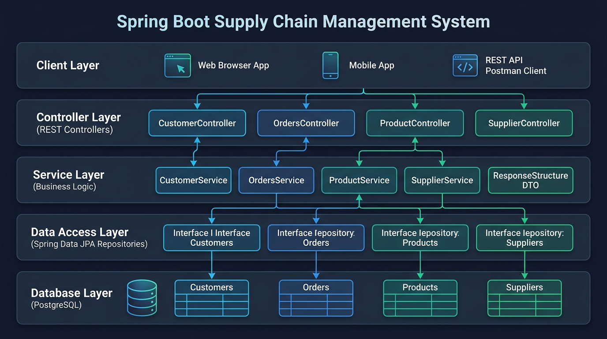
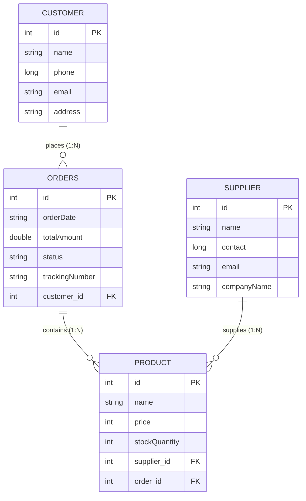

# 📦 Supply Chain Management System

[](https://www.oracle.com/java/)
[](https://spring.io/projects/spring-boot)
[](https://www.postgresql.org/)
[](https://maven.apache.org/)
[](https://restfulapi.net/)

The **Supply Chain Management System** is an enterprise-grade backend RESTful service developed using **Java** and **Spring Boot**. It is engineered to streamline and automate core supply chain and retail workflows, including vendor relationship management, customer order processing, real-time shipment/order tracking, and product inventory tracking backed by a relational database (**PostgreSQL**).

---

## 🏛️ System Architecture

The project adheres to the **Layered (N-Tier) Architectural Pattern**, ensuring strict separation of concerns, high maintainability, and loose coupling.



### Architectural Layers

1. **Client / Presentation Layer**: REST API consumers such as web interfaces, mobile clients, and API testing platforms (e.g., Postman).
2. **Controller Layer (`Controller/`)**: Exposes RESTful endpoints, handles HTTP requests, deserializes JSON request bodies, and returns standardized HTTP status codes.
3. **Service Layer (`Services/`)**: Encapsulates core business rules, entity validations, relationship associations (e.g., binding an order to an existing customer), and constructs generic API response envelopes (`ResponseStructure<T>`).
4. **Data Access Object (DAO) Layer (`Dao/`)**: Acts as a repository abstraction layer, separating business rules from direct persistence interactions.
5. **Repository Layer (`repository/`)**: Leverages **Spring Data JPA** (`JpaRepository`) to generate optimized SQL queries and derived methods (`findByCustomerId`, `findByTrackingNumber`, `findBySupplierId`).
6. **Persistence Layer**: Relational database persistence powered by **PostgreSQL** via Hibernate ORM.

---

## 🗄️ Domain Model & Entity Relationships

The data model connects the four primary business entities:



### Relationship Breakdown

- **Customer ➔ Orders (`One-to-Many`)**: One customer can place multiple orders. Managed with `cascade = CascadeType.ALL` and `@JsonIgnore` on the child reference to avoid circular serialization recursion.
- **Supplier ➔ Product (`One-to-Many`)**: A vendor can supply multiple catalog products.
- **Orders ➔ Product (`One-to-Many`)**: Each order aggregates multiple purchased products.

---

## ✨ Key Features

- **👤 Customer Management**: Comprehensive CRUD operations for managing customer personal details, contact info, and order histories.
- **🏭 Supplier Management**: Full vendor directory tracking supplier contact details, company information, and catalog supplies.
- **📦 Product & Inventory Management**: Cataloging products with pricing and stock quantities; filtering products by their supplier ID.
- **🛒 Order Tracking & Fulfillment**: 
  - Associating newly generated orders directly with validated customer profiles.
  - Tracking packages and shipment statuses dynamically using unique tracking numbers (`trackingNumber`).
  - Retrieving order history per customer.
- **🛡️ Standardized API Response Envelope**: Consistent response contracts across all endpoints utilizing `ResponseStructure<T>`.

---

## 📋 Standardized Response Structure

All endpoints return a uniform JSON format:

```json
{
  "statusCode": 200,
  "message": "fetched Successfully",
  "data": { ... }
}
```

| Field | Type | Description |
| :--- | :--- | :--- |
| `statusCode` | `int` | Standard HTTP Status Code (200, 201, 404, etc.) |
| `message` | `String` | Descriptive status or error message |
| `data` | `T` (Generic) | Returned payload (object, array, or `null`) |

---

## 🔌 API Reference & Endpoints

### 1. Customer Endpoints (`/customer`)

| Method | Endpoint | Description |
| :--- | :--- | :--- |
| `POST` | `/customer` | Register a new customer |
| `GET` | `/customer/{id}` | Retrieve customer by ID |
| `GET` | `/customer` | Retrieve all customers |
| `PUT` | `/customer` | Update existing customer details |
| `DELETE` | `/customer/delete/all` | Delete customer records |

<details>
<summary><b>Sample Payload (Customer POST/PUT)</b></summary>

```json
{
  "name": "Alex Mercer",
  "phone": 9876543210,
  "email": "alex.mercer@example.com",
  "address": "123 Tech Park, Silicon Valley, CA"
}
```
</details>

---

### 2. Order Endpoints (`/orders`)

| Method | Endpoint | Description |
| :--- | :--- | :--- |
| `POST` | `/orders/customers/{id}` | Create an order linked to customer `id` |
| `GET` | `/orders/{id}` | Retrieve order details by Order ID |
| `GET` | `/orders` | Retrieve all orders |
| `GET` | `/orders/customers/{customerId}` | Retrieve all orders placed by a specific customer |
| `GET` | `/orders/tracking/{trackingNumber}`| Track shipment status via tracking number |
| `PUT` | `/orders` | Update existing order |
| `DELETE` | `/orders/delete/all` | Delete orders |

<details>
<summary><b>Sample Payload (Create Order POST)</b></summary>

```json
{
  "orderDate": "2026-11-11",
  "totalAmount": 149.99,
  "status": "In Transit",
  "trackingNumber": "TRK-98234-XYZ"
}
```
</details>

---

### 3. Product Endpoints (`/product`)

| Method | Endpoint | Description |
| :--- | :--- | :--- |
| `POST` | `/product` | Add a new product to inventory |
| `GET` | `/product/{id}` | Retrieve product by ID |
| `GET` | `/product` | Retrieve all inventory products |
| `GET` | `/product/supplier/{supplierId}` | Fetch all products supplied by a specific vendor |
| `PUT` | `/product` | Update product details or stock |
| `DELETE` | `/product` | Delete products |

<details>
<summary><b>Sample Payload (Product POST/PUT)</b></summary>

```json
{
  "name": "Wireless Mechanical Keyboard",
  "price": 120,
  "stockQuantity": 85
}
```
</details>

---

### 4. Supplier Endpoints (`/supplier`)

| Method | Endpoint | Description |
| :--- | :--- | :--- |
| `POST` | `/supplier` | Add a new vendor/supplier |
| `GET` | `/supplier/{id}` | Retrieve supplier details by ID |
| `GET` | `/supplier` | Retrieve list of all suppliers |
| `PUT` | `/supplier` | Update supplier details |
| `DELETE` | `/supplier` | Delete supplier records |

<details>
<summary><b>Sample Payload (Supplier POST/PUT)</b></summary>

```json
{
  "name": "Global Tech Logistics",
  "contact": 9123456789,
  "email": "contact@globaltech.com",
  "companyName": "Global Tech Industries Ltd."
}
```
</details>

---

## 🛠️ Tech Stack & Dependencies

| Technology | Purpose |
| :--- | :--- |
| **Java 17+** | Programming language |
| **Spring Boot 3.3.x** | Core backend application framework |
| **Spring Data JPA** | Data persistence, ORM, and query abstraction |
| **PostgreSQL** | Primary relational database |
| **Jackson** | JSON serialization / deserialization & bidirectional relationship handling |
| **Maven** | Dependency management and build automation |

---

## 🚀 Getting Started

### Prerequisites

Make sure you have installed:
- **JDK 21 or higher** (`java -version`)
- **Apache Maven 3.8+** (`mvn -v`)
- **PostgreSQL Database Server** running on port `5432`

---

### 1. Database Setup

1. Open PostgreSQL command line (`psql`) or pgAdmin:
   ```sql
   CREATE DATABASE "SupplyChainManagementSystemDB";
   ```
2. Verify credentials in `src/main/resources/application.properties`:
   ```properties
   spring.application.name=SupplyChainManagementSystem
   spring.datasource.url=jdbc:postgresql://localhost:5432/SupplyChainManagementSystemDB
   spring.datasource.username=postgres
   spring.datasource.password=root
   spring.datasource.driver-class-name=org.postgresql.Driver

   spring.jpa.hibernate.ddl-auto=update
   spring.jpa.show-sql=true
   spring.jpa.properties.hibernate.dialect=org.hibernate.dialect.PostgreSQLDialect
   ```

---

### 2. Build & Run the Application

Clone the repository and run using the Maven wrapper:

```bash
# Clone the repository
git clone https://github.com/SKKhatai/Supply-Chain-Management-System.git
cd Supply-Chain-Management-System

# Run with Maven Wrapper
./mvnw clean spring-boot:run
```

*(On Windows PowerShell, use `.\mvnw.cmd clean spring-boot:run`)*

Once started, the server will listen on:
```
http://localhost:8080
```

---

## 📁 Project Directory Structure

```
Supply-Chain-Management-System/
├── docs/
│   └── system-architecture.jpg        # System architecture diagram
├── src/
│   ├── main/
│   │   ├── java/org/SupplyChainManagementSystem/
│   │   │   ├── Controller/            # REST Controllers (Endpoints)
│   │   │   │   ├── CustomerController.java
│   │   │   │   ├── OrdersController.java
│   │   │   │   ├── ProductController.java
│   │   │   │   └── SupplierController.java
│   │   │   ├── Services/              # Business Logic Layer
│   │   │   │   ├── CustomerService.java
│   │   │   │   ├── OrdersService.java
│   │   │   │   ├── ProductService.java
│   │   │   │   └── SupplierService.java
│   │   │   ├── Dao/                   # Data Access Objects (DAOs)
│   │   │   │   ├── CustomerDAO.java
│   │   │   │   ├── OrdersDAO.java
│   │   │   │   ├── ProductDAO.java
│   │   │   │   └── SupplierDAO.java
│   │   │   ├── repository/            # Spring Data JPA Repositories
│   │   │   │   ├── CustomerRepository.java
│   │   │   │   ├── OrdersRepository.java
│   │   │   │   ├── ProductRepository.java
│   │   │   │   └── SupplierRepository.java
│   │   │   ├── Entity/                # JPA Database Entities
│   │   │   │   ├── Customer.java
│   │   │   │   ├── Orders.java
│   │   │   │   ├── Product.java
│   │   │   │   └── Supplier.java
│   │   │   ├── Dto/                   # Data Transfer Objects
│   │   │   │   └── ResponseStructure.java
│   │   │   └── SupplyChainManagementSystemApplication.java  # Main Application Class
│   │   └── resources/
│   │       └── application.properties # PostgreSQL Database & JPA configuration
│   └── test/                          # Unit and Integration Tests
├── pom.xml                            # Maven Dependencies & Configuration
└── README.md                          # Project Documentation
```

---

## 🗺️ Roadmap & Potential Enhancements

- [ ] **Springdoc OpenAPI / Swagger UI**: Integrate interactive API testing at `/swagger-ui.html`.
- [ ] **Security (JWT & Spring Security)**: Role-based access control (RBAC) for Admin, Suppliers, and Customers.
- [ ] **Specific Record Deletion**: Update `DELETE` methods to delete individual entities by ID (`DELETE /{id}`) instead of bulk deletion.
- [ ] **Global Exception Handler**: Implement `@RestControllerAdvice` to gracefully handle `ResourceNotFoundException` and database constraint violations.
- [ ] **Dockerization**: Provide a `Dockerfile` and `docker-compose.yml` bundling Spring Boot and PostgreSQL for one-click setup.

---

## 🤝 Contributing

Contributions, issues, and feature requests are welcome!
1. Fork the Project
2. Create your Feature Branch (`git checkout -b feature/AmazingFeature`)
3. Commit your Changes (`git commit -m 'Add some AmazingFeature'`)
4. Push to the Branch (`git push origin feature/AmazingFeature`)
5. Open a Pull Request

---

## 📄 License

This project is licensed under the MIT License - feel free to use and modify it for learning and commercial projects.
